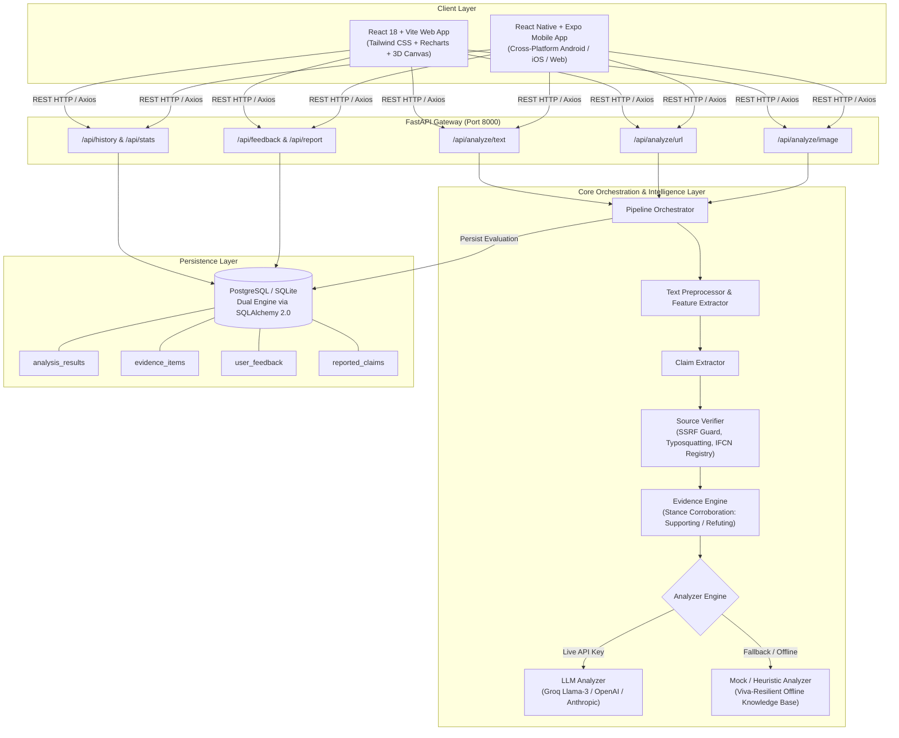

# TruthShield: Social Media & Misleading Information Detection Platform

[](https://fastapi.tiangolo.com)
[](https://react.dev)
[](https://tailwindcss.com)
[](https://www.sqlalchemy.org)
[](https://expo.dev)
[](https://github.com)
[-blueviolet)](https://aktu.ac.in)

> **Major Project Submission for Master of Computer Applications (MCA)**  
> **Course:** MCA 3rd/4th Semester Major Project (Code: KCA-451 / Mini Project KCA-351)  
> **Institution:** Greater Noida Institute of Technology (GNIOT), Knowledge Park II, Greater Noida (College Code: 132)  
> **Affiliated to:** Dr. A.P.J. Abdul Kalam Technical University (AKTU), Lucknow, Uttar Pradesh  
> **Department:** Department of Computer Application (DCA)  
> **Under the Guidance of:** **Dr. Saumya Chaturvedi**, Associate Professor, DCA, GNIOT  

---

## 👥 Academic Team & Project Roles

*Strictly aligned with Page 9 of the submitted AKTU Synopsis:*

| Team Member | University Roll No. | Project Responsibility & Layer |
|---|---|---|
| **Yaseen Jamshed** | `2501320140158` | **Backend Core & Architecture:** FastAPI ASGI service, REST routing, Pydantic v2 data schemas, `SourceVerifier` (SSRF/typosquatting protection), and `EvidenceEngine`. |
| **Vandana** | `2501320140151` | **Frontend Engineering & UI/UX:** React 18, Tailwind CSS, Lucide icons, Recharts analytics, 3D HTML5 Canvas Globe visual, and mobile-responsive layouts. |
| **Aarti Vishwakarma** | `2501320140001` | **AI & Machine Learning Layer:** Prompt engineering, Multi-LLM provider abstraction (Groq Llama-3, OpenAI, Anthropic), heuristic knowledge base, and confidence calibration. |
| **Soni** | `2501320140140` | **Database & Persistence Layer:** SQLAlchemy 2.0 ORM schemas, dual database engine (PostgreSQL + local SQLite fallback), transactional CRUD, history logging, and stats aggregation. |

---

## 📌 Executive Summary & Research Motivation

The uncontrolled propagation of false claims across peer-to-peer messaging networks (such as WhatsApp) and algorithmic feeds (Instagram, X, Facebook) poses severe real-world dangers to public health, social stability, and financial safety. 

Existing commercial fact-checking tools suffer from critical shortcomings:
1. **Binary Oversimplification:** Labeling statements merely as "True" or "False" ignores the nuanced reality that modern misinformation consists predominantly of authentic facts placed in deceptive or exaggerated contexts.
2. **Deceptive "94% Accuracy" Claims:** Many systems claim unsubstantiated 90%+ accuracy metrics without active test dataset evaluation.
3. **No Educational Value:** Traditional checkers fail to teach the reader *how* to evaluate evidence for themselves.

### 🛡️ TruthShield Invariants & Design Principles
- **Explanation-First UX:** Rather than an authoritative binary stamp, TruthShield outputs an explicit atomic claim summary, 3+ bulleted *"Why This Result?"* rationale statements, source domain reputation, stance-tagged corroboration (`SUPPORTING`, `REFUTING`, `CONTEXTUAL`), and actionable *"Think Before You Share"* guidelines.
- **Calibrated AI Confidence (0.50 – 0.98):** TruthShield rejects fake accuracy statistics. All confidence metrics represent mathematical credibility estimates based on empirical corroboration and linguistic manipulation indicators.
- **AI Is Not Absolute Truth:** Every evaluation is presented as an *AI-assisted credibility assessment*, reminding users that automated tools assist, but do not replace, verified journalistic verification.
- **4-Tier Classification Standard:**
  1. `Likely Reliable`: Validated by accredited governmental agencies or established journalistic publishers.
  2. `Potentially Misleading`: Real facts distorted through sensationalism, clickbait, or missing context.
  3. `Likely False`: Directly contradicted by empirical evidence, scientific consensus, or fact-checkers.
  4. `Needs Further Verification`: Insufficient corroboration or ambiguous personal claims requiring manual cross-checking.

---

## 🏗️ System Architecture



---

## 📂 Monorepo Structure

```
news-deduction/
├── backend/                             # FastAPI Backend & Intelligence Layer
│   ├── app/
│   │   ├── api/                         # REST API Route Handlers
│   │   │   ├── routes_analyze.py        # Text, URL, and Image analysis endpoints
│   │   │   ├── routes_history.py        # Paginated history & aggregated dashboard stats
│   │   │   └── routes_meta.py           # Health check, user feedback, community reporting
│   │   ├── core/
│   │   │   └── config.py                # Pydantic BaseSettings, CORS, DB & AI configs
│   │   ├── database/
│   │   │   └── session.py               # SQLAlchemy 2.0 dual-engine (PostgreSQL/SQLite)
│   │   ├── models/
│   │   │   └── models.py                # ORM Tables: results, reasons, evidence, feedback
│   │   ├── schemas/
│   │   │   └── analysis.py              # Pydantic v2 Request/Response validation schemas
│   │   └── services/                    # Business Logic & Pipeline Stages
│   │       ├── analyzer_factory.py      # Dynamic Dependency Injection for analyzers
│   │       ├── base_analyzer.py         # Abstract Base Class contract
│   │       ├── claim_extractor.py       # Atomic claim isolation
│   │       ├── db_service.py            # Transactional database CRUD operations
│   │       ├── evidence_engine.py       # Stance tagging (SUPPORTING, REFUTING, CONTEXTUAL)
│   │       ├── llm_analyzer.py          # Multi-LLM provider orchestration with fallback
│   │       ├── llm_service.py           # Groq / OpenAI / Anthropic API callers
│   │       ├── mock_analyzer.py         # Calibrated heuristic engine (100% viva uptime)
│   │       ├── orchestrator.py          # 6-Stage Pipeline Coordinator
│   │       ├── source_verifier.py       # Domain reputation, SSRF, & typosquatting detection
│   │       └── text_preprocessor.py     # Cleaning, normalization, viral feature extraction
│   ├── test_api.py                      # 13 Database & API integration tests
│   ├── test_sources.py                  # 6 Source verifier & evidence stance tests
│   ├── test_llm.py                      # 3 LLM abstraction & fallback resilience tests
│   ├── test_e2e.py                      # 13 Multi-modal end-to-end integration tests
│   └── requirements.txt                 # Python dependencies (FastAPI, SQLAlchemy, Pillow)
│
├── frontend/                            # React 18 + Vite Modern Web Application
│   ├── src/
│   │   ├── components/                  # Design System Components
│   │   │   ├── AnalyzeBox.jsx           # Multi-modal input tabs & 1-tap presets
│   │   │   ├── AwarenessSection.jsx     # Digital literacy & 30-Second Rule
│   │   │   ├── ConfidenceMeter.jsx      # Animated SVG circular gauge (0.50–0.98)
│   │   │   ├── EvidenceCard.jsx         # Stance-tagged evidence citations
│   │   │   ├── Footer.jsx               # AKTU/GNIOT project attributions & links
│   │   │   ├── GlobeVisual.jsx          # 3D HTML5 Canvas digital Earth with orbiting tokens
│   │   │   ├── HeroSection.jsx          # Split-grid landing hero
│   │   │   ├── HowItWorks.jsx           # 6-stage pipeline interactive cards
│   │   │   ├── Navbar.jsx               # Responsive glassmorphic navigation bar
│   │   │   ├── ResultCard.jsx           # Explanation-first assessment report
│   │   │   └── SourceCard.jsx           # Domain credibility rating card
│   │   ├── pages/                       # Multi-page React Application
│   │   │   ├── HomePage.jsx             # Hero, 3D Canvas visual, and feature showcases
│   │   │   ├── AnalyzePage.jsx          # Dedicated verification workbench
│   │   │   ├── DashboardPage.jsx        # Aggregated analytics, Recharts, and DB history
│   │   │   ├── HowItWorksPage.jsx       # Academic methodology & pipeline overview
│   │   │   ├── LearnPage.jsx            # 8 Media Literacy Principles & viral spotting guide
│   │   │   └── AboutPage.jsx            # GNIOT team profiles, supervisor, and AKTU synopsis
│   │   ├── services/
│   │   │   └── api.js                   # Axios client with fallback resilience & error parsing
│   │   ├── App.jsx                      # React Router v6 navigation
│   │   └── index.css                    # Tailwind CSS & custom animations
│   ├── index.html                       # HTML5 entry with metadata
│   └── package.json                     # Frontend dependencies
│
├── mobile/                              # Cross-Platform React Native (Expo) Mobile App
│   ├── src/
│   │   ├── components/
│   │   │   └── BottomNav.js             # 5-tab floating bottom navigation
│   │   ├── screens/
│   │   │   ├── SplashScreen.js          # Animated GNIOT/AKTU splash screen
│   │   │   ├── HomeScreen.js            # Mobile landing screen & 4-tier cards
│   │   │   ├── AnalyzeScreen.js         # Tabbed input [Text, URL, Screenshot] & presets
│   │   │   ├── ResultScreen.js          # Explanation-first mobile assessment report
│   │   │   ├── HistoryScreen.js         # FlatList of past evaluations from DB
│   │   │   ├── LearnScreen.js           # Interactive 8 literacy principle cards
│   │   │   └── SettingsScreen.js        # Dynamic backend API URL switcher & credentials
│   │   └── services/
│   │       └── api.js                   # Mobile Axios adapter with configurable host
│   ├── App.js                           # State router & safe-area navigation
│   ├── app.json                         # Expo configuration
│   └── package.json                     # Mobile dependencies
│
├── database/                            # Database & Persistence Layer (Lead: Soni)
│   ├── schema.sql                       # Complete PostgreSQL DDL (Table 2 + operational tables)
│   ├── seed_data.sql                    # Seed verified sources (WHO, PIB, RBI, IFCN) & reference claims
│   ├── init_db.py                       # SQLAlchemy 2.0 multi-engine initialization & audit
│   ├── chroma_setup.py                  # ChromaDB vector store collection setup & indexing
│   ├── manage_db.bat                    # 1-click Windows database management launcher
│   └── README.md                        # Database architecture, schemas, and connection guide
│
├── ai_ml/                               # AI & Machine Learning Layer (Lead: Aarti Vishwakarma)
│   ├── datasets/                        # Labeled benchmark datasets & loader
│   │   ├── training_claims.json         # Annotated claims (Real, Misleading, False-Fake)
│   │   └── dataset_loader.py            # Train/test partition splitting utility
│   ├── feature_extractor.py             # Linguistic manipulation, sensationalism & urgency metrics
│   ├── train_classifier.py              # TF-IDF + Logistic Regression training pipeline
│   ├── predictor.py                     # Production inference engine & behavioral nudge generator
│   ├── embeddings.py                    # Semantic dense vector representations & cosine search
│   ├── evaluate_benchmarks.py           # Quantitative validation suite (Macro-F1, Accuracy, ECE)
│   ├── saved_models/                    # Serialized model weights (classifier.pkl, vectorizer.pkl)
│   ├── train_models.bat                 # 1-click model training & evaluation runner
│   └── README.md                        # AI/ML architecture, mathematical formulations & benchmarks
│
├── docs/                                # College Project Documentation & Research Papers
│   ├── research_paper.md                # Formal Academic Research Paper (IEEE/Springer standards)
│   ├── PAPER_DEFENSE_PRESENTATION.md    # 15-Slide Presentation Deck, script & Examiner FAQs
│   ├── VIVA_PRESENTATION_GUIDE.md       # Examiner Q&A, scripts, and demo guide
│   ├── architecture.md                  # System architecture specifications
│   ├── methodology.md                   # Research methodology & algorithm workflows
│   └── api.md                           # REST API endpoint reference
│
├── docker-compose.yml                   # Production container orchestration
└── README.md                            # Comprehensive project manual
```

---

## ⚡ Quick Start Guide (Windows PowerShell)

### Prerequisites
- **Python 3.10+** (Python 3.13 tested)
- **Node.js v18+ or v22+**
- **Git**

---

### Step 1: Start the FastAPI Backend

Open a PowerShell terminal:
```powershell
cd "c:\Users\Yaseen Jamshed\OneDrive\Desktop\news deduction\backend"

# 1. Create and activate virtual environment (if not already created)
python -m venv venv
.\venv\Scripts\activate

# 2. Install backend dependencies
pip install -r requirements.txt

# 3. Launch ASGI development server on port 8000
uvicorn app.main:app --reload --port 8000
```
- **Live API Root:** `http://127.0.0.1:8000`
- **Interactive Swagger Docs:** `http://127.0.0.1:8000/docs`
- **Health Check Endpoint:** `http://127.0.0.1:8000/api/health`

> **Note on Database:** TruthShield employs zero-configuration automatic SQLite database creation (`backend/misinfo_app.db`) on startup. PostgreSQL is natively supported by specifying `DATABASE_URL` in `.env`.

---

### Step 2: Start the React Web Frontend

Open a second PowerShell terminal:
```powershell
cd "c:\Users\Yaseen Jamshed\OneDrive\Desktop\news deduction\frontend"

# 1. Install frontend packages (first time only)
npm.cmd install

# 2. Start the Vite development server
npm.cmd run dev
```
- Open your browser to: **`http://localhost:5173`**
- Test production build anytime via: `npm.cmd run build`

---

### Step 3: Run the Cross-Platform Mobile App (React Native / Expo)

Open a third PowerShell terminal:
```powershell
cd "c:\Users\Yaseen Jamshed\OneDrive\Desktop\news deduction\mobile"

# 1. Install mobile dependencies
npm.cmd install

# 2. Run mobile application in web mode:
npx.cmd expo start --web

# Or run via Expo Go on physical device (scan QR code):
npx.cmd expo start
```

---

## 🧪 Comprehensive Automated Testing (35/35 Passing)

TruthShield includes an exhaustive 35-test automated verification suite covering database integrity, source credibility heuristics, LLM abstraction, and end-to-end multi-modal analysis.

Run all test suites in PowerShell:
```powershell
cd "c:\Users\Yaseen Jamshed\OneDrive\Desktop\news deduction"

# Execute all 4 verification suites:
backend\venv\Scripts\python.exe backend/test_api.py; `
backend\venv\Scripts\python.exe backend/test_sources.py; `
backend\venv\Scripts\python.exe backend/test_llm.py; `
backend\venv\Scripts\python.exe backend/test_e2e.py
```

### Test Breakdown:
- **`backend/test_api.py` (13 tests):** Validates database initialization, health check, text/URL/image routing, PostgreSQL/SQLite fallback, stats computation, and feedback persistence.
- **`backend/test_sources.py` (6 tests):** Validates typosquatting imposter detection, IFCN fact-checking registry matching, official authority verification, and SSRF private IP blocking.
- **`backend/test_llm.py` (3 tests):** Validates multi-LLM prompt constraints, structured JSON schema enforcement, and seamless fallback resilience.
- **`backend/test_e2e.py` (13 tests):** Comprehensive multi-modal validation across all 4 tier classifications, in-memory image uploading, corrupt file rejection, and live analytics updates.

---

## 📊 Core API Endpoints

| Method | Endpoint | Description |
|---|---|---|
| `GET` | `/api/health` | Service health, active AI provider, DB status, and AKTU team credits |
| `POST` | `/api/analyze/text` | Preprocesses text, extracts claims, and generates 4-tier assessment |
| `POST` | `/api/analyze/url` | Evaluates publisher domain reputation and checks IFCN/government registries |
| `POST` | `/api/analyze/image` | Ingests screenshot/flyer (PNG, JPEG, WEBP), performs integrity check & evaluation |
| `GET` | `/api/results/{id}` | Fetches stored assessment report by unique UUID |
| `GET` | `/api/history` | Returns paginated past evaluations from the relational database |
| `GET` | `/api/stats` | Aggregates classification counts and percentage distribution |
| `POST` | `/api/feedback` | Records user satisfaction (`is_helpful`) and qualitative commentary |
| `POST` | `/api/report` | Enables community crowdsourcing of emerging viral claims |

---

## 🐳 Docker Containerization

To run the entire ecosystem (PostgreSQL, FastAPI Backend, React Frontend) via Docker:

```powershell
docker compose up --build
```
- Web Application: `http://localhost:3000`
- API Backend: `http://localhost:8000`
- Database: PostgreSQL on port `5432`

---

## 📚 Academic References

1. **Rodríguez Castillo et al. (2026):** *Explanation-based debunking mechanisms and contextual nudges in social media platforms.*
2. **Ozcelik et al. (2025):** *Multi-stage heuristic verification architectures for cross-platform misinformation mitigation.*
3. **Tomassi et al. (2024):** *Linguistic markers and psychological urgency cues in algorithmic clickbait dissemination.*
4. **International Fact-Checking Network (IFCN):** *Code of Principles for Non-Partisan Fact-Checking Organizations.* Poynter Institute.
5. **World Health Organization (WHO):** *Coronavirus disease (COVID-19) advice for the public: Mythbusters.*

---

## 🎓 Viva Voce & Presentation Documentation

For full viva defense preparation, examiner questions & answers, live demonstration scripts, and offline contingency plans, consult:
👉 **[docs/VIVA_PRESENTATION_GUIDE.md](file:///c:/Users/Yaseen%20Jamshed/OneDrive/Desktop/news%20deduction/docs/VIVA_PRESENTATION_GUIDE.md)**

---

*Developed with academic dedication by the MCA Project Team (2025–2027) at GNIOT, Greater Noida, affiliated to Dr. A.P.J. Abdul Kalam Technical University (AKTU), Lucknow.*
